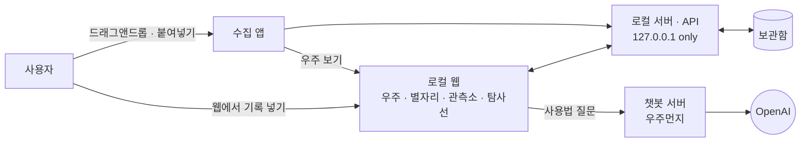

# 🌌 SpaceLog

> 흩어진 기록을 모아, 한눈에 보이는 나만의 우주 — **기록 수집에서 우주 관제소로**

맥·윈도우의 가벼운 **수집 앱**으로 기록을 모으고, **로컬 웹의 우주**에서 보고 둘러보고 다시 만나고, 고른 묶음을 **Claude용으로 내보낸다.**
지금은 사용자가 직접 넣은 기록만 모은다. 다음 목표는 **AI 챗봇이 기록을 찾아 주고, 여러 서비스의 기록이 한 우주에 모이고, 그 우주를 다른 사람과 나누며, 기록을 게임·퀴즈로 다시 만나게 하는 것**이다.

> **상태**: `SPACELOG-2.5D` 브랜치 진행 중 · 팀 마감(2026-11-11)·데모(11-12) 이후 디벨롭 · 원래 팀에서 **PO와 개발자 일부가 빠지고**, 남은 **개발자 2명 · 디자이너 2명**이 이어서 진행한다 · 아래 **4장 이후는 제안(초안)** 이며 확정 전이다.

---

## 1. 원래 약속 (기존 README 요약)

- **모으기**(수집 앱)와 **다시 만나기**(재발견)가 두 축이다.
- 기록은 **내 PC에만** 저장한다. 로그인·클라우드·텔레메트리가 없다.
- 수집 앱은 모으기만 하고, 보기·정리·내보내기는 로컬 웹이 맡는다.
- 원래 팀은 한 사람당 빅 피처 하나(수집 앱 · 재발견 · 서버 · 우주 · 디자인)를 맡았고, 화면은 3D안으로 정했다. **PO와 개발자 일부가 빠지면서 이 분담은 그대로 이어지지 않는다. 남은 개발자 2명 · 디자이너 2명이 새로 나눠야 한다.**

기획·정책·스펙은 [PRD](docs/PRD.md) · [POLICY](docs/POLICY.md) · [SPEC](docs/SPEC.md), 근거는 [RESEARCH](docs/RESEARCH.md) 참고.

---

## 2. 달라진 점 · 추가된 점 (`SPACELOG-2.5D`)

| 영역 | 기존 | 지금 |
| --- | --- | --- |
| **보기 방식** | 3D(비행·착륙) 한 가지 | **2D · 2.5D · 3D 전환.** 새 디자인 토큰, 상단 바·오른쪽 창, 좁은 화면(휴대폰)까지 대응 |
| **행성 다루기** | 이름 변경·생성·삭제·합치기 | **위치 편집**(끌어 옮기기), 행성 추가(색·모양 고르기), **블랙홀**(행성 보관·꺼내기·완전 삭제), 고른 행성에 초점을 맞추는 심도 효과 |
| **기록 넣기** | 수집 앱에서만 (웹은 "하지 않는 것") | **웹에서도 넣기** — 메모·링크·파일, 끌어다 놓기·붙여넣기 |
| **기록 묶기** | 행성(카테고리)뿐 | **별자리** — 여러 행성의 기록에 "관측 목적"을 붙여 묶고, 우주 위에 선과 이름표로 표시 |
| **보여주기** | 별 목록·상세 | **관측소** — 별자리를 대시보드(CSV 열 기준 막대·도넛)·표·사진 모아보기·텍스트 모아보기 4가지로 본다. 한국어 엑셀 CSV(CP949)도 읽는다 |
| **재발견** | 알림 + 별 상세 | 웹에도 **재발견 혜성 카드**, 행성 간 최근 기록 시각 카드, 관측소의 "재발견 혜성 관측" |
| **안내** | 없음 | **우주먼지 챗봇** — 화면 안 대화창, 정해진 답 12개 + AI(OpenAI `gpt-5-mini`) 답변, 가리키는 버튼 옆으로 날아가 "Here!"로 위치 안내 ([chatbot/](chatbot/README.md)) |
| **수집 앱** | 기본 스타일 | 새 스타일·문구, 접힌 손잡이를 우주먼지로, 둥근 드롭존 |
| **체험·소개** | 받는 곳 안내 한 장 | **How to use 체험 페이지** — 설치 전에 "넣기 → 우주 → 재발견"을 5단계로 체험. 실제 제품 웹을 예시 데이터로 빌드해 쓴다 ([site/](site/README.md)) |

탐사선(Claude용 내보내기)은 그대로 유지한다. 기록 삭제 복구·검색·태그는 아직 없다.

### 지금의 한계

- **별자리·행성 위치·블랙홀·CSV 내용은 그 브라우저에만 저장된다.** 다른 브라우저·PC에서는 보이지 않고, 포트가 바뀌면(47800 → 47801) 사라진 것처럼 보인다.
- CSV 대시보드는 서버가 CSV 내용을 주지 않아서, 관측소에서 같은 파일을 한 번 골라 줘야 한다.
- 챗봇은 **사용법만** 안내한다. 사용자의 기록은 볼 수 없다.
- 기록은 **사용자가 직접 넣은 것만** 모인다.

---

## 3. 구조 (현재)

폴더: `apps/collector` 수집 앱 · `apps/server` 로컬 서버 · `web` 로컬 웹 · `chatbot` 챗봇 서버 · `site` 받는 곳 + 체험 페이지 · `packages/shared` 공용 타입 · `docs` 기획·디자인 문서.

---

## 4. 제안: 우주 관제소 (향후 목표)

**컨셉**: 기록을 수집만 하지 않고 **시각화해서 보여준다.** 노션·슬랙·캘린더·깃허브 같은 여러 곳의 기록을 한 스페이스(우주)에 모아, 우주 관제소·스페이스 전시처럼 보여준다.

| # | 기능 | 내용 |
| --- | --- | --- |
| ① | **챗봇 확장** | 사용법 안내를 넘어 **기록 찾기**(자연어로 "지난달 디자인 시안 어디 있지?") + 사용자 **안내자** 역할 |
| ② | **MCP 연결** | 노션 · 슬랙 · 구글 캘린더 · 깃허브 등을 붙여 **기록으로 가져오기**. 직접 넣은 기록과 같은 우주에서 본다 |
| ③ | **스페이스 (DB)** | 프로젝트별로 **여러 스페이스** 만들기. 공개 스페이스·링크로 **입장·구경**. 공유 시 **민감 정보는 가릴 수 있게** |
| ④ | **재발견 강화** | 지금의 재발견(알림·혜성 카드)에 **방탈출 게임 · 퀴즈**를 붙인다. 내 기록으로 문제를 만들어 풀면서 다시 만나게 하고, 같은 방식이 **서비스 소개·홍보**에도 쓰인다(체험 페이지 등) |

> **①~④ 모두 팀과 논의하기 전이다.** 세부(게임 규칙, 문제를 만드는 방식, 연결할 서비스, 공개 범위)는 정해지지 않았고 다시 이야기해야 한다. 이 장은 건의를 위한 방향 제안이다.

### 제안 순서 (초안)

1. **로컬 안에서 끝나는 것부터** — ① 챗봇이 로컬 기록을 찾는다. 서버·계정이 필요 없다.
2. **가져오기** — ② 연결은 읽기 전용부터 시작하고, 가져온 기록은 보관함에 복사한다.
3. **공유** — ③ DB·스페이스·공개는 가장 마지막. 계정과 저장 위치가 정해져야 한다.
4. **재발견 강화(④)의 순서는 미정** — 퀴즈는 로컬 기록만으로 만들 수 있어 1단계에 가깝고, 방탈출 게임·홍보 활용은 규모와 목적을 먼저 이야기해야 한다.

### 기존 약속과 부딪히는 곳 — 먼저 정해야 한다

| 기존 약속 | 제안이 바꾸는 것 | 정할 것 |
| --- | --- | --- |
| 기록은 내 PC에만 | 스페이스 DB·공개는 기록이 PC 밖으로 나간다 | 로컬 우선을 유지하고 **공개하는 스페이스만** 올릴지 |
| 로그인·클라우드 없음 | 스페이스·링크 입장에 계정이 필요할 수 있다 | 계정 방식(로그인 vs 링크 토큰만) |
| 챗봇은 기록을 볼 수 없다 | 기록 찾기는 챗봇이 기록을 읽는다 | 기록 검색을 **로컬에서만** 할지, AI에 어떤 내용까지 보낼지 |
| 밖으로 나가는 요청은 링크 제목 GET 1회뿐 | MCP 연결은 외부 서비스에 인증 요청이 나간다 | 토큰 보관 위치, 읽기 전용 범위 |
| 공유·협업·MCP 직접 조회는 이번에 하지 않음 | 모두 이번 제안에 들어 있다 | [POLICY](docs/POLICY.md) · [PRD](docs/PRD.md) 범위 개정 |
| (신규) 공개 시 민감 정보 | 가릴 항목의 기준이 없다 | 경로·이메일·토큰 등 자동 가림 규칙과 올리기 전 미리보기 |
| (신규) 기록으로 만드는 게임·퀴즈 | 문제를 만들려면 기록 내용을 읽어야 하고, 홍보에 쓰면 남에게 보인다 | 문제 생성에 AI를 쓸지, 홍보·체험에는 **예시 데이터만** 쓸지 |

이 표가 정해져야 기능 단위의 스펙·이슈로 쪼갤 수 있다.

---

## 5. 성공 기준 (기존 유지 + 제안)

| 기준 | 목표 |
| --- | --- |
| 모으기가 빠르다 | 드롭 → 저장 완료 3초 이내 |
| 한눈에 보인다 | 웹 첫 화면에서 조작 0회로 기간의 행성 전체가 보임 |
| 다시 만난다 (핵심) | 재발견 알림·카드를 연 비율 — 목표 수치 없이 측정만 |
| *(제안)* 찾는다 | 챗봇에 물어서 원하는 기록 상세까지 도달 — 기준은 ①을 만들 때 정한다 |
| *(제안)* 모인다 | 외부 서비스 기록 1종 이상이 같은 우주에 보임 — 기준은 ②를 만들 때 정한다 |
| *(제안)* 게임으로 다시 만난다 | 게임·퀴즈를 통해 다시 열어 본 기록 수 — 기준은 ④를 만들 때 정한다 |

---

## 6. 문서 · 협업

| 문서 | 내용 |
| --- | --- |
| [docs/PRD.md](docs/PRD.md) · [POLICY.md](docs/POLICY.md) · [SPEC.md](docs/SPEC.md) | 기획서 · 정책서 · 스펙서 |
| [docs/DESIGN.md](docs/DESIGN.md) · [docs/adr/](docs/adr/) | 디자인 토큰 · 기술 결정 (수집 앱·서버 스택, 웹 스택) |
| [chatbot/README.md](chatbot/README.md) | 우주먼지 챗봇 서버 (실행·환경 변수·배포) |
| [site/README.md](site/README.md) | 받는 곳 · How to use 체험 페이지 |

**Git 수칙**: ① 브랜치 시작 전 최신 `main` 당기기 ② PR 전 `main`으로 rebase (훅이 자동 차단) ③ 작성자 외 1명 이상 Approve. 클론 후 한 번 `git config core.hooksPath .githooks`.
협업 스킬 팩(`/setup` → `/prd` → `/toPolicy` → `/toSpec` → `/toIssue` → `/impl` → `/pr`)은 [skills/](skills/)에 있다.
