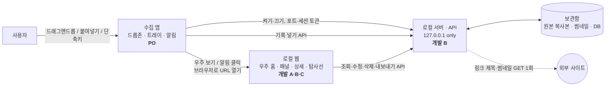
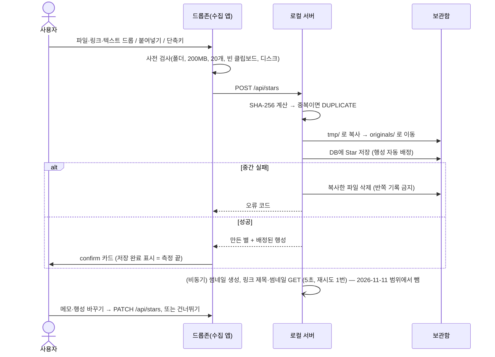

# 📐 상세 구현 명세 (SPEC)

> **상태**: 1차 초안 · 2026-11-11 · 기준 문서 [docs/PRD.md](PRD.md), [docs/POLICY.md](POLICY.md)
> PRD Q7은 **3D안으로 정해졌다** (2026-11-11). 이 문서의 1-4, 2-5 `camera`, 3-5(비행·착륙), 6장 S1·S3은 원래 3D안 기준으로 썼으므로 그대로 둔다. 다만 `DESIGN.md`(PR #24)와 한 줄씩 대조하지는 않았다 SQ4(패널이 열려 있어도 비행 키를 받고 멀어지면 닫는다, 이슈 #36·`DESIGN.md` v0.5·PR #40)는 이 문서 2-5 `closePanel`·3-5에 **아직 반영하지 않았다**. 데이터 모델(2장)과 API(2-6)는 어느 안이든 같다.
> **(잠정)** 표시는 PRD 열린 질문(Q1·Q3·Q9)이나 1주 차 측정에 따라 바뀔 수 있는 값이다. **(SPEC 제안)** 표시는 PRD·POLICY에 없어 이 문서가 처음 정한 값으로, 담당자가 1주 차 초에 확정한다.
> 정책 근거는 `P 2-2`처럼 POLICY 절 번호로 적는다.
> **2.5D 디자인 적용 중 (`SPACELOG-2.5D` 브랜치, 2026-11-12~).** [2.5D 디자인 핸드오프](design/2.5d/design_handoff_spacelog_2_5d/README.md) 4장의 "팀 문서와 어긋나는 점"을 단계별로 반영한다. 1단계에서 반영한 것: **화면 문구 "별" → "기록"**(이 문서 본문의 "별"과 코드의 `Star`는 같은 것을 가리킨다), 토스트 표시 시간 약 2.4초. 데이터 모델(2장)과 API(2-6)는 바꾸지 않았다. 서버와 공유 타입은 시연용 단계에서는 바꾸지 않는다(핸드오프 README 4-1).

## 0. 전체 구성



- 밖으로 나가는 요청은 링크 정보 가져오기 하나뿐이다 (P 1-1).
- 수집 앱은 **넣기와 넣은 직후 확인만** 한다. 보기·정리·내보내기는 모두 로컬 웹이 한다.

---

## 1. 화면 및 UI 컴포넌트 구조

### 1-1. 수집 앱 — 드롭존 (구현 PO · 디자인 디자이너 2)

화면 가장자리에 붙어 떠 있는 작은 창. 항상 위(always-on-top), 작업 표시줄·Dock에 아이콘을 띄우지 않는다.

| 상태 | 화면 | 들어가는 상태 | 나가는 조건 |
| --- | --- | --- | --- |
| `collapsed` | 가장자리에 붙은 얇은 손잡이(우주먼지 빛무리 + 오늘 별 개수). 누른 채 끌면 세로로 옮겨지고 그 자리를 기억한다 (오른쪽 가장자리에 붙은 채) | 앱 시작, 확인 완료·건너뛰기 | 클릭(또는 Enter) → `expanded`, 파일 끌고 들어옴 → `dragOver`. 마우스를 올리기만 해서는 펼치지 않는다 |
| `expanded` | 드롭 영역("여기에 끌어다 놓으세요 · ⌘/Ctrl+V"), [우주 보기], [⚙ 설정] | 손잡이 클릭, 트레이 아이콘 클릭 | 마우스 나감 2초 후 → `collapsed` |
| `dragOver` | 드롭 영역 강조, "놓으면 별이 돼요" | 파일·텍스트·링크를 끌고 들어옴 | 놓음 → `saving`, 끌고 나감 → 이전 상태 |
| `saving` | 진행 표시 "별을 만드는 중… (n/N)" | 드롭, 붙여넣기, 전역 단축키 | 성공 → `confirm`, 실패 → `error` |
| `confirm` | **넣은 직후 확인 카드** (아래) | 저장 성공 | [완료]·[건너뛰기]·`Enter`·`Esc`·자동 접힘 → `collapsed` |
| `error` | 붉은 토스트 + 이유 (P 3-3 문구) | 거부·실패 | 4초 후 또는 클릭 → 이전 상태 |

**넣은 직후 확인 카드** (P 2-3, 2-6)
- 썸네일(또는 유형 아이콘) + 제목(파일 이름 / 링크 도메인 / 텍스트 앞 30자)
- 여러 개를 한 번에 넣었으면 "별 N개를 넣었어요"와 썸네일 최대 4개
- `배정된 행성` 드롭다운: 현재 행성 목록 + "미분류". 바꾸면 이번에 넣은 모든 별에 같이 적용
- `한 줄 메모` 입력: 한 줄, 최대 140자, 글자 수 표시 `0/140`
- [완료] · [건너뛰기]
- 자동 접힘: 입력이 없으면 **10초 후** 접히며 지금 값(기본 배정)으로 확정 (SPEC 제안). 메모 입력이나 드롭다운을 건드리면 타이머를 멈춘다.
- 한 번 접히면 다시 열 수 없다. 이후 정리는 웹에서 한다.

**드롭존 경고·안내** (P 3-1, 3-3)
- 남은 디스크 1GB 미만: 드롭 영역 위에 노란 띠 "디스크 공간이 부족해요 (남은 공간 N MB)"
- 중복 파일: "이미 [행성]에 있는 별이에요" (새 기록 안 만듦)
- 폴더: "폴더는 아직 넣을 수 없어요. 파일을 넣어 주세요"
- 200MB 초과·21번째 이후: 넘은 파일만 이름과 이유를 나열, 나머지는 저장
- 보관함 접근 불가: "보관함을 찾을 수 없어요" + [설정 열기]

### 1-2. 수집 앱 — 트레이·메뉴바와 설정 (구현 PO)

| 요소 | 내용 |
| --- | --- |
| 트레이·메뉴바 아이콘 | 상태 3종: 정상 / 서버 오류(빨간 점) / 보관함 오류(노란 점) |
| 아이콘 메뉴 | 우주 보기 · **오늘의 별 보기** · 드롭존 보이기/숨기기 · 클립보드 넣기(단축키 표시) · 설정 · 종료 |
| 전역 단축키 | 지금 클립보드 내용을 기록 1개로 저장 → 드롭존이 펼쳐지며 `confirm`. 기본값 `⌘⇧Space` / `Ctrl+Shift+Space` (SPEC 제안) |
| 설정 창 | 단축키 바꾸기 · 재발견 알림 켜기/끄기 · 로그인 시 자동 실행 · 보관함 위치(경로, [폴더 열기], [위치 바꾸기]) · 디스크 사용량(보관함 크기 / 남은 공간) |

> **구현에서 정해진 것 (2026-11-11, `feat/#6-collector`)**
> - **설정은 수집 앱이 가진다.** `userData/settings.json`에 저장하고 서버 API(`/api/settings`)를 쓰지 않는다. 보관함 위치는 서버를 띄울 때 `SPACELOG_VAULT`로 넘긴다.
> - **디스크 남은 공간은 수집 앱이 직접 잰다** (`fs.statfs`). `/api/storage`를 쓰지 않는다.
> - **로그인 시 자동 실행은 개발 모드에서 값만 저장하고 운영체제에 등록하지 않는다.** 데모는 개발 모드로 하므로 이 항목은 시연 대상이 아니다.
> - **"오늘의 별 보기"** 는 알림 클릭이 안 될 때를 위한 두 번째 입구다 (1-3, PRD 8장 리스크).

> **개발 전용 알림 시각 (SPEC 제안, PO)**: 환경 변수 `SPACELOG_NOTIFY_AT="HH:MM"`이 있으면 2-4의 `notificationTime`을 덮어쓴다. 데모에서 15:00을 기다릴 수 없기 때문이다 (DEMO 1장 사전 준비). 설정 창에는 넣지 않고, 배포 빌드에서는 읽지 않는다.

### 1-3. 수집 앱 — 재발견 알림 (표시 PO · 별 고르기 개발 A)

- 운영체제 기본 알림. 제목 `N일 전 오늘의 별 ✦`, 본문 `{별 제목} · {행성 이름}`
- 클릭 → 로컬 웹을 `#/star/{starId}?from=rediscovery` 로 연다 (3-4 흐름)
- **알림 클릭이 동작하지 않을 때의 두 번째 입구**: 트레이 메뉴의 **"오늘의 별 보기"** 가 같은 주소를 연다. 웹의 재발견 카드가 세 번째 입구다 (PRD 8장 리스크)
- 보내는 시각·조건은 P 2-2를 따른다. 별 고르기 결과는 서버 API(`GET /api/rediscovery/today`)에서 받는다.

### 1-4. 로컬 웹 — 우주 홈 (구현 개발 C · 디자인 디자이너 1)

```
┌───────────────────────────────────────────────────────────────┐
│ [TopBar] ✦ SpaceLog      별 128 · 행성 7   [오늘|이번 주|직접 지정]  [🚀 탐사선 3] │
├───────────────────────────────────────────────────────────────┤
│ [Banner 영역: 서버 끊김 / 기간 자동 확장 / 성능 상한 / WebGL 없음]      │
├──────────────┬────────────────────────────────────────────────┤
│ [PlanetList] │                                                │
│ ● 이미지 42  │              [UniverseCanvas 3D]               │
│ ● 링크  31   │                                                │
│ ● 문서  20   │                                  [Rediscovery  │
│ ○ 기타   0   │                                   Card]        │
│ ＋ 새 행성    │                                                │
│              │ [ControlsHint] WASD 비행 · Space/Shift 상승·하강 │
│              │  드래그 시점 · 휠 앞뒤 · E 착륙                  │
└──────────────┴────────────────────────────────────────────────┘
         (행성 패널·별 상세는 오른쪽 사이드 패널로 열림)
```

| 컴포넌트 | 내용 | 규칙 |
| --- | --- | --- |
| `TopBar` | 서비스 이름, 기간 안의 별 개수·행성 개수, 기간 선택, 탐사선 버튼(실은 개수 배지) | 기간: 오늘 / 이번 주 / 직접 지정(날짜 2개, 최대 1년) (P 2-1) |
| `PeriodPicker` | 세그먼트 버튼 + 직접 지정 시 날짜 선택 팝오버 | 1년 초과 선택 시 종료일을 시작일+1년으로 자르고 안내 |
| `PlanetList` | 행성 이름, 기간 안의 별 개수, 색 점. 별 수 내림차순, "미분류"는 맨 아래 | 기간 안 0개인 행성은 흐리게(○), 클릭 시 날아가지 않고 패널만 연다 (P 2-5) |
| `UniverseCanvas` | 3D 장면: 배경 별무리, 행성(구), 행성 주위를 도는 별(작은 점·구), 궤도선 | 6장 3D 규칙 |
| `RediscoveryCard` | "N일 전 오늘의 별" + 썸네일 + 제목 + 행성 이름, [보러 가기], [닫기] | 후보가 없으면 렌더링하지 않음. 닫으면 그날은 다시 안 띄움 |
| `ControlsHint` | 조작 안내 한 줄: WASD 비행 · Space/Shift 상승·하강 · 드래그 시점 · 휠 앞뒤 · E 착륙 (2D는 이동·확대 문구) | 항상 펼쳐 둔다. `?` 접기와 [⌂ 조망] 버튼은 없앴다 (2026-11-12). 모든 행성 보기는 확대 조절의 배율(맞춤) 버튼 |
| `Banner` | 상단 띠 배너 1개(우선순위 높은 것 1개만) | 우선순위: 서버 끊김 > WebGL 없음 > 성능 상한 > 기간 자동 확장 |
| `EmptyState` | 3D 위에 겹치는 안내 | 7장 빈 상태 표 |
| `Onboarding` | 전체 기록 0건일 때 첫 실행 안내(드롭존 위치, 단축키) | P 3-2 |

### 1-5. 로컬 웹 — 행성 패널 (구현 개발 B · 디자인 디자이너 2)

오른쪽 사이드 패널(폭 약 400px). 열려 있는 동안 3D는 해당 행성을 화면 왼쪽 2/3에 두고 계속 돈다.

| 영역 | 요소 | 규칙 |
| --- | --- | --- |
| 헤더 | 행성 색 점, 행성 이름(클릭 → 인라인 편집), 별 개수(기간 안 / 전체), [✕ 닫기] | 이름 1~20자, 앞뒤 공백 제거, 대소문자 무시 중복 금지 (P 2-4). "미분류"는 편집 불가 |
| 툴바 | [🚀 행성 싣기] · [⋯ 더보기: 다른 행성과 합치기 / 행성 삭제 / 새 행성] | 삭제는 별 0개일 때만 활성. "미분류"는 삭제·합치기(원본 쪽) 불가 |
| 별 목록 | `StarListItem`: 체크박스, 썸네일, 제목, 넣은 시각 `YYYY.MM.DD HH:mm`, 메모 1줄 미리보기, ⚠(원본 없음) | 기본은 **기간 안의 별**, 토글로 "전체 보기". 최신순. 클릭 → 별 상세 |
| 선택 바 | 체크한 별이 1개 이상일 때 하단에 고정: "N개 선택" [🚀 싣기] [다른 행성으로 옮기기] | |
| 빈 상태 | "아직 이 행성에 별이 없어요" + [행성 삭제] | P 3-2 |
| 합치기 대화상자 | 대상 행성 고르기 → "‘A’의 별 N개를 ‘B’로 옮기고 ‘A’를 지워요. 되돌릴 수 없어요." [합치기] [취소] | P 2-4 |
| 새 행성 대화상자 | 이름 입력, 검증 오류 인라인 | 행성 50개 도달 시 "행성은 50개까지 만들 수 있어요" |
| 키워드 편집 (고도화 후보) | [⋯ 더보기: 키워드 편집] → 쉼표로 구분한 키워드 목록 | P 2-3. 1주 차 끝 진척에 따라 다음 단계로 넘길 수 있다. 그 전까지 키워드는 고정 |

### 1-6. 로컬 웹 — 별 상세 (구현 개발 B · 디자인 디자이너 2)

행성 패널 안에서 슬라이드로 바뀌는 상세 뷰 ([← 행성으로] 뒤로가기).

| 영역 | 종류별 내용 |
| --- | --- |
| 미리보기 | **이미지**: 썸네일(클릭 시 원본 크기 라이트박스) · **파일**: 유형 아이콘 + 파일 이름 + 크기 · **링크**: 썸네일 + 링크 제목 + URL(새 탭으로 열기) · **텍스트**: 본문 스크롤 영역(최대 높이 고정) |
| 메타 | 종류, 행성, 넣은 시각, 원래 파일 이름 |
| 메모 | 여러 줄 입력, 최대 1,000자, 포커스 아웃 시 저장, 저장 표시 "저장됨" |
| 동작 | [원본 열기] · [폴더에서 보기] (파일·이미지만) · [행성 옮기기 ▾] · [🚀 싣기] · [🗑 삭제] |
| 원본 없음 ⚠ | "원본을 찾을 수 없어요" 경고, [원본 열기]·[폴더에서 보기] 비활성 (P 3-4) |
| 삭제 확인 | "이 별을 지우면 보관함의 복사본도 영구히 지워져요. 원래 파일은 그대로예요." [삭제] [취소] (P 2-9) |

- 원본 파일은 편집하지 않는다. 바꿀 수 있는 것은 메모와 행성뿐이다.
- 링크 제목이 없으면 도메인, 썸네일이 없으면 유형 아이콘, 파일 이름이 없으면 "이름 없는 기록", 메모가 없으면 메모 영역에 placeholder만 보인다 (P 2-7).

### 1-7. 로컬 웹 — 탐사선 (구현 개발 A · 디자인 디자이너 2)

TopBar의 [🚀 탐사선] 버튼으로 여는 큰 모달(또는 전체 화면 패널).

```
┌──────────────── 🚀 탐사선 ────────────────────────────┐
│ [실은 목록]                │ [형식] (●) Claude 프롬프트  ( ) MCP 리소스 │
│ ▣ 행성: 링크 (31)    ✕     │ ┌──────── 미리보기 ─────────────┐ │
│ ▣ 별: 회의 캡처.png   ✕     │ │ <archive period="...">        │ │
│ ▣ 별: 아이디어 메모   ✕     │ │ ...                           │ │
│                           │ └───────────────────────────────┘ │
│ [+ 기간 안 우주 전체 싣기]   │ 18,240자 · ⚠ 내용이 길어요(>50,000)  │
│ [모두 비우기]               │                     [📋 복사하기] │
└───────────────────────────────────────────────────────┘
```

| 요소 | 규칙 |
| --- | --- |
| 실은 목록 | 항목 종류: 별 / 행성 / 기간 우주 전체. 같은 별이 여러 항목에 겹치면 내보낼 때 1번만 넣는다 |
| 형식 선택 | Claude 프롬프트(기본) / MCP 리소스. 축소 조건이 발동하면 MCP 리소스 라디오를 숨긴다 (PRD 3장 4번) |
| 미리보기 | 읽기 전용, 고정폭 글꼴. 형식이나 목록이 바뀌면 다시 만든다 |
| 글자 수 | 전체 글자 수 표시. 50,000자 초과 시 경고, 복사는 막지 않음 (P 2-8) |
| [복사하기] | 실은 것이 0개면 비활성 (P 3-2). 성공 시 토스트 "복사했어요. Claude에 붙여넣으세요" |
| 복사 실패 | 미리보기를 전체 선택된 편집 가능한 텍스트 상자로 바꾸고 "직접 선택해 복사해 주세요" (P 3-4) |

### 1-8. 공통 컴포넌트 (디자이너 2 · 디자이너 1 컬러 토큰)

| 컴포넌트 | 쓰는 곳 |
| --- | --- |
| `Button` (primary / secondary / danger / ghost) | 전체 |
| `SidePanel` (헤더·본문·하단 고정 영역) | 행성 패널, 별 상세 |
| `Modal`, `ConfirmDialog` (danger 버튼 포함) | 합치기, 삭제, 탐사선 |
| `Toast` (정보 / 성공 / 오류, 약 2.4초. 2.5D 디자인) | 복사 완료, 저장 오류 |
| `Banner` (경고 띠 + 액션 버튼) | 서버 끊김, 기간 확장 |
| `Thumbnail` (이미지 / 유형 아이콘 대체) | 목록, 상세, 확인 카드, 재발견 카드 |
| `KindIcon` (image / file / link / text) | 전체 |

---

## 2. 데이터 모델 (Data Schema)

1일 차에 개발 B가 이 초안으로 API 목업을 내고 개발 3명과 PO가 확정한다 (PRD 6장 공통 약속). 저장소는 보관함 안의 단일 DB 파일(예: SQLite)을 제안한다 (Q3는 Electron으로 확정됨. Q9 결정 시 확정, 잠정).

### 2-1. Star (기록 / 별)

```typescript
type StarKind = "image" | "file" | "link" | "text";

interface Star {
  id: string;                 // ULID (넣은 순서로 정렬 가능)
  kind: StarKind;
  planetId: string;

  // 시각 (P 1-4): UTC + 넣을 때의 시간대 오프셋
  createdAtUtc: string;       // ISO 8601, 예 "2026-11-11T06:12:03Z"
  tzOffsetMin: number;        // 예 540 (KST)
  updatedAtUtc: string;

  // 원본 (image·file, 그리고 100,000자 초과 text → .txt 파일)
  storagePath: string | null; // 보관함 기준 상대 경로, 예 "originals/2026/11/01J...png"
  originalName: string | null;// 원래 파일 이름. 없으면 화면에 "이름 없는 기록"
  mimeType: string | null;
  sizeBytes: number | null;
  sha256: string | null;      // 중복 검사 (P 2-6), 유니크 인덱스

  // 링크
  url: string | null;
  linkTitle: string | null;   // 없으면 화면에 도메인
  linkDomain: string | null;  // 예 "youtube.com"

  // 텍스트 (100,000자 이하)
  textBody: string | null;

  // 썸네일 (P 1-5)
  thumbnailPath: string | null;
  thumbnailStatus: "pending" | "ready" | "fallback";  // fallback = 유형 아이콘

  // 링크 정보 가져오기 (P 1-5, 3-1)
  linkFetchStatus: "none" | "pending" | "done" | "failed";

  memo: string | null;        // 수집 앱 140자 / 웹 1,000자

  // 서버가 조회 시 계산해 내려주는 값 (저장 안 함)
  originalMissing?: boolean;  // 보관함에서 원본이 사라짐 ⚠ (P 3-4)
  localDate?: string;         // "2026-11-11", PC 현지 시간 기준
}
```

| 화면 표시 상태 | 조건 |
| --- | --- |
| 정상 | 위 값이 모두 있음 |
| 처리 중 | `thumbnailStatus = pending` 또는 `linkFetchStatus = pending` → 썸네일 자리에 스켈레톤 |
| 원본 없음 ⚠ | `originalMissing = true` |
| 링크 정보 없음 | `linkFetchStatus = failed` → 도메인을 제목으로, 경고 없음 |

### 2-2. Planet (행성)

```typescript
interface Planet {
  id: string;                  // ULID. 시스템 행성은 고정 id
  name: string;                // 1~20자, 대소문자 무시 유니크
  system: "uncategorized" | null; // "미분류"만 값이 있음 → 이름 변경·삭제 불가
  colorToken: string;          // 디자이너 1의 행성 테마 토큰 이름, 예 "planet-3"
  createdAtUtc: string;

  // 조회 시 계산
  starCountInPeriod?: number;
  starCountTotal?: number;
}
```

- 첫 실행 시 기본 행성 7개를 만든다: 업무, 공부, 개발, 디자인, 읽을거리, 생활, 미분류 (P 2-3, Q1 키워드 규칙).
- 키워드(도메인·확장자 포함)는 **DB 전용 컬럼**(`keywords`, JSON 배열)에 둔다. MVP API에는 내보내지 않는다. 키워드 편집(고도화 후보, P 2-3)을 넣을 때 `Planet.keywords: string[]`와 `PATCH /api/planets/:id`의 `keywords`를 추가한다.
- 이전 초안의 `defaultFor`(파일 유형 배정용)는 뺐다. `packages/shared/types.ts`·`mocks/api/`는 #4에서 맞춘다.
- 행성 최대 50개(미분류 포함) (P 2-4 잠정).

### 2-3. 재발견 (개발 A)

```typescript
interface RediscoveryPick {      // 하루 1행. 알림과 웹 카드가 같은 별을 보이게 하는 기준
  localDate: string;             // "2026-11-11" (PK)
  starId: string | null;         // 후보가 없으면 null → 그날은 알림·카드 없음
  daysAgo: 7 | 14 | 30 | null;
  pickedAtUtc: string;
}

interface RediscoveryEvent {     // 성공 기준 "다시 만난다" 측정값 (P 2-2)
  id: string;
  localDate: string;
  starId: string;
  channel: "notification" | "card";
  type: "shown" | "opened" | "dismissed";
  atUtc: string;
}
```

### 2-4. Settings (수집 앱이 가진다)

```typescript
interface Settings {
  vaultPath: string;               // 보관함 위치
  shortcut: string;                // 예 "CommandOrControl+Shift+Space"
  rediscoveryNotification: boolean;// 기본 true
  notificationTime: "15:00";       // (잠정) P 2-2
  // 개발 전용: 환경 변수 SPACELOG_NOTIFY_AT="HH:MM"이 있으면 이 값을 덮어쓴다.
  // 데모에서 15:00을 기다릴 수 없어 둔 장치다 (DEMO 1장 사전 준비). 배포 빌드에서는 읽지 않는다 (SPEC 제안, PO)
  launchAtLogin: boolean;          // 기본 true
  lastNotifiedLocalDate: string | null; // 몰아 보내기 방지
  onboardingDone: boolean;
}
```

**저장 위치**: 수집 앱의 `userData/settings.json` (2026-11-11 구현에서 확정). 서버는 설정 API를 두지 않는다. 서버가 알아야 하는 보관함 위치는 서버를 띄울 때 `SPACELOG_VAULT`로 넘긴다.

### 2-5. 웹 클라이언트 상태 (웹 화면 계약, 개발 A·B·C 합의 대상)

```typescript
interface WebState {
  period: { preset: "today" | "week" | "custom"; from: string; to: string }; // 현지 날짜
  periodAutoExpanded: boolean;     // 오늘 0건 → 이번 주로 넓힘
  stars: Star[]; planets: Planet[];
  connection: "ok" | "lost";
  lastSyncedAt: string | null;

  camera: "overview" | "flight" | "flyingTo" | "landed";
  selectedPlanetId: string | null; // 패널이 열린 행성
  selectedStarId: string | null;   // 상세가 열린 별

  cargo: CargoItem[];              // 탐사선에 실은 목록
  exportFormat: "claude" | "mcp";
}

type CargoItem =
  | { type: "star"; starId: string }
  | { type: "planet"; planetId: string; period: WebState["period"] }
  | { type: "universe"; period: WebState["period"] };
```

웹 내부에서 주고받는 호출 (컴포넌트 사이 계약):

| 호출 | 누가 부르나 | 하는 일 |
| --- | --- | --- |
| `flyToPlanet(planetId, then?: "openPanel")` | PlanetList, RediscoveryCard | 카메라를 행성 앞까지 자동 비행 → 도착 시 `openPanel` |
| `openPanel(planetId)` | 3D 착륙, flyToPlanet 완료, 흐린 행성 클릭 | `selectedPlanetId` 설정, URL `#/planet/:id` |
| `openStar(starId)` | 별 목록, 3D 별 클릭, 딥링크 | 패널을 해당 행성으로 열고 상세로 전환, URL `#/star/:id` |
| `closePanel()` | ✕, `Esc` | 선택 해제, 카메라는 그 자리에서 `flight` |
| `returnToOverview()` | ⌂ 조망, `Esc`(패널 닫힌 상태) | 카메라를 조망 위치로 이동 |
| `addToCargo(item)` / `removeFromCargo(i)` | 행성 패널, 별 상세, 탐사선 | 실은 목록 갱신. 같은 항목은 중복으로 넣지 않음 |
| `setPeriod(period)` | PeriodPicker, 딥링크 | 데이터 다시 받기 → 3D 갱신 |

URL(해시 라우팅): `#/` 우주 홈 · `#/planet/:id` · `#/star/:id` · `#/probe` 탐사선. 새로고침해도 같은 화면으로 돌아온다.

### 2-6. 로컬 API (개발 B, 1일 차 목업)

공통: `http://127.0.0.1:{port}/api/...`, 모든 요청에 `X-Session-Token` 헤더. 오류는 `{"error": {"code": "...", "message": "화면에 보일 한국어 문구"}}`.

| 메서드 · 경로 | 쓰는 쪽 | 설명 |
| --- | --- | --- |
| `GET /api/health` | 수집 앱, 웹 | 서버 살아 있음 확인 (토큰 필요) |
| `GET /api/universe?from=&to=` | 웹 | 기간 안의 별 + 모든 행성(기간 내·전체 별 개수 포함). 3D와 목록의 단일 소스 |
| `GET /api/stars/:id` | 웹 | 별 1개 (텍스트 본문 포함) |
| `POST /api/stars` | 수집 앱 · 웹(기록 넣기, 2026-11-12) | 기록 넣기. `multipart` 파일 여러 개(최대 20) 또는 `{kind:"text"\|"link", text\|url}`. 응답: 만든 별들, 중복·거부 목록 |
| `PATCH /api/stars` | 수집 앱 | 넣은 직후 확인: `{ids[], planetId?, memo?}` 일괄 적용 |
| `PATCH /api/stars/:id` | 웹 | `{memo?, planetId?}` |
| `POST /api/stars/move` | 웹 | `{ids[], planetId}` 여러 별 옮기기 |
| `DELETE /api/stars/:id` | 웹 | 기록 + 보관함 복사본 영구 삭제 |
| `POST /api/stars/:id/open` | 웹 | `{mode:"file"\|"folder"}` 운영체제 기본 앱 / 파일 탐색기로 열기 |
| `GET /api/stars/:id/thumbnail` · `/original` | 웹 | 이미지 바이트 (미리보기용) |
| `POST /api/planets` · `PATCH /api/planets/:id` · `DELETE /api/planets/:id` | 웹 | 만들기 · 이름 바꾸기 · 빈 행성 삭제 |
| `POST /api/planets/:id/merge` | 웹 | `{targetId}` A를 B에 합치기 |
| `GET /api/rediscovery/today` | 수집 앱, 웹 | 오늘의 픽(없으면 만들고 저장) → `{star, daysAgo}` 또는 `null` |
| `POST /api/rediscovery/events` | 수집 앱, 웹 | 뜬 횟수·연 횟수·닫은 횟수 기록 |
| `POST /api/export` | 웹 | `{items: CargoItem[], format}` → `{content, charCount, overLimit}` |
| ~~`GET /api/settings` · `PATCH /api/settings` · `GET /api/storage`~~ | — | **두지 않는다 (2026-11-11).** 설정은 수집 앱의 `userData/settings.json`, 남은 공간은 수집 앱이 직접 잰다 (1-2). 보관함 크기가 필요해지면 그때 다시 본다 |

오류 코드: `UNAUTHORIZED` · `FORBIDDEN_ORIGIN` · `DUPLICATE` · `FOLDER_NOT_ALLOWED` · `FILE_TOO_LARGE` · `TOO_MANY_FILES` · `UNSUPPORTED_CLIPBOARD` · `TEXT_EMPTY` · `PLANET_NAME_INVALID` · `PLANET_NAME_DUPLICATE` · `PLANET_LIMIT` · `PLANET_NOT_EMPTY` · `PLANET_SYSTEM` · `VAULT_UNAVAILABLE` · `DISK_FULL` · `ORIGINAL_MISSING` · `NOT_FOUND` · `INVALID_REQUEST`(본문이 JSON이 아니거나 너무 큼, 필수 값 없음. 2026-11-11 개발 B 추가)

### 2-7. 보관함 폴더 구조 (개발 B)

```
{vaultPath}/
├─ archive.db               # Star, Planet, RediscoveryPick, RediscoveryEvent, Settings
├─ originals/YYYY/MM/{starId}.{ext}
├─ thumbnails/{starId}.webp
└─ tmp/                     # 복사 중 파일. 실패·재시작 시 비움
```

---

## 3. 핵심 로직 및 인터랙션 흐름

### 3-1. 수집 앱 시작 · 서버 연결 (PO · 개발 B)

1. 로그인 시 수집 앱 자동 실행 → 드롭존 `collapsed`로 표시.
2. 세션 토큰(무작위 32바이트, base64url)을 새로 만든다 (P 1-3).
3. 로컬 서버를 `127.0.0.1`의 기본 포트(예 `47800`, SPEC 제안)로 켠다. 사용 중이면 +1씩 최대 10번 시도.
4. 서버가 `GET /api/health`에 응답하면 준비 완료. 서버가 꺼지면 1번 자동 재시작, 또 실패하면 트레이 빨간 점 + 운영체제 알림 (P 3-1).
5. 서버는 매 요청에서 확인한다: `Host`가 `127.0.0.1:{port}`·`localhost:{port}`인가 → `Origin`이 있으면 자기 자신인가 → 토큰이 맞는가. 하나라도 틀리면 403/401. CORS 헤더는 보내지 않는다.

### 3-2. 기록 넣기 (PO · 개발 B) — 목표: 놓은 순간 → 저장 완료 3초 이내



> **2026-11-11 PO 축소**: 위 흐름의 마지막 줄(비동기 썸네일 생성, 링크 제목·썸네일 GET)은 **이번 범위에서 뺀다** (PRD 3장). `thumbnailPath`·`linkTitle`은 비어 있고, 화면은 종류 아이콘과 도메인으로 대체한다 (1-5, P 2-7에 이미 정해진 대체 규칙). 서버가 밖으로 나가는 요청을 아예 하지 않으므로 POLICY 1-1의 유일한 예외도 이번엔 발생하지 않는다.

- **종류 판별**: 파일 → 이미지 MIME이면 `image`, 아니면 `file`. 텍스트가 `http(s)://`로 시작하는 URL 한 줄이면 `link`, 아니면 `text`. 텍스트가 100,000자를 넘으면 **수집 앱이** `.txt` 파일로 만들어 `multipart`로 올리고 `file`로 저장한다 (P 2-6, 2026-11-11 구현에서 주체 확정).
- **행성 자동 배정** (P 2-3 키워드 규칙): 파일 이름·확장자·링크 도메인(경로 제외)·텍스트 앞 2,000자를 행성 키워드와 비교해 도메인 → 확장자 → 키워드 개수 순으로 고른다. 행성 이름도 키워드다. 맞는 행성이 없으면 미분류. 링크 제목은 저장 뒤에 오므로 쓰지 않는다.
- 여러 파일을 넣으면 파일마다 Star를 만들고, 거부된 파일은 이유와 함께 따로 돌려준다 (P 3-3).

### 3-3. 웹 초기 로드 (개발 C)

1. 수집 앱이 브라우저로 `http://127.0.0.1:{port}/#/?token={세션토큰}` 을 연다(딥링크는 `#/star/{id}?token=…`). 해시는 서버로 전송되지 않는다.
2. 웹은 토큰을 `sessionStorage`에 넣고 주소창에서 지운다(`history.replaceState`). 토큰이 없거나 401이면 "수집 앱의 [우주 보기]로 다시 열어 주세요" 화면.
3. WebGL 확인 → 없으면 3D 없이 `PlanetList` + 패널만 + 배너 (P 3-1).
4. `GET /api/universe?from=오늘&to=오늘` 와 `GET /api/rediscovery/today` 를 동시에 부른다.
5. 빈 상태 판정 (7장 표) → 필요하면 이번 주로 넓혀 다시 부르고 배너 표시.
6. 3D 장면을 **조망 시점**으로 그린다: 모든 행성의 경계 구가 화면에 다 들어가도록 카메라 거리 계산 (성공 기준 "조작 0회").
7. 재발견 픽이 있으면 `RediscoveryCard` 표시 + `events{channel:"card", type:"shown"}` (그날 처음 한 번만).

### 3-4. 기간 바꾸기 · 다시 받기 (개발 C)

- 기간 변경 → `GET /api/universe` → 행성 크기 다시 계산 → 새 행성은 서서히 나타나고 사라질 행성은 서서히 사라진다 (전환 약 400ms).
- 창이 다시 포커스를 받으면 현재 기간으로 다시 받는다 (P 1-5). 실시간 동기화는 하지 않는다.
- 요청 실패 → `connection = "lost"`, 마지막 데이터 유지, 배너 "수집 앱이 꺼져 있거나 응답하지 않아요" + [다시 시도] (P 3-1). 다시 시도 성공 시 배너 자동 제거.
- 패널·상세가 열린 상태에서 기간을 바꾸면 패널은 유지하고 목록만 갱신한다.

### 3-5. 3D 우주 · 비행 · 착륙 (개발 C · 디자이너 1)

| 항목 | 규칙 |
| --- | --- |
| 행성 배치 | 행성 id로 시드를 만든 고정 위치(나선 또는 원판 배치). 기간이 바뀌어도 같은 행성은 같은 자리 (SPEC 제안) |
| 행성 크기 | `r = base × (1 + log2(1 + n))`, `base ≤ r ≤ 4·base`, `n` = 기간 안 별 개수. `n = 0`이면 그리지 않음 (P 2-5) |
| 별 | 행성 주위 궤도를 돈다. 궤도 반지름 `r × (1.6 ~ 3.0)` 무작위(별 id 시드), 각속도는 느리게 일정. 색은 `kind`, 밝기는 최근일수록 밝게 (디자이너 1 규칙 대기) |
| 성능 상한 | 기간 안 별 > 2,000개면 별은 그리지 않고 행성 + 개수 라벨만. 배너 "기간을 좁히면 별이 보여요" (P 3-4 잠정) |
| 조망 시점 | 카메라 고정 궤도 회전(마우스 드래그로 회전, 휠로 줌). 행성 hover → 이름·별 개수 툴팁, 클릭 → `flyToPlanet` |
| 비행 모드 | 캔버스를 클릭하거나 `WASD`를 누르면 `flight`. `W/S` 앞뒤, `A/D` 좌우, `Space` 상승, `Shift` 하강, 마우스 드래그 시점. 입력창에 포커스가 있으면 키 입력 무시 |
| 착륙 | 카메라가 행성 표면에서 `3r` 안에 들어오면 "E 착륙" 안내 표시 → `E` 또는 행성 클릭 → 짧은 접근 연출 후 `openPanel` (`landed`) |
| 자동 비행 | `flyToPlanet`: 현재 위치 → 행성 앞 `2.5r` 지점까지 1.2초 이징 이동 → `openPanel`. 축소 시 연출 없이 즉시 이동 (PRD 3장 축소 순서) |
| 별 클릭 | 3D에서 별 클릭 → `openStar` |
| `Esc` | 상세 → 패널 → 패널 닫기 → 조망 순서로 한 단계씩 뒤로 |

### 3-6. 재발견 (개발 A · PO)

**오늘의 픽 고르기** (`GET /api/rediscovery/today` 내부, P 2-2):

```
if pick(오늘 localDate) 있음 → 그대로 반환   // 알림과 카드가 같은 별
for d in [7, 14, 30]:
    후보 = 별 중 localDate(createdAtUtc, tzOffset 대신 현재 PC 시간대) == 오늘 − d
    후보 −= 최근 30일 안에 RediscoveryPick.starId 였던 별
    if 후보 비어 있지 않음:
        후보를 id 오름차순 정렬
        index = hash32(오늘 localDate 문자열) mod 후보 수      // 날짜 시드 랜덤
        pick 저장(starId, daysAgo = d) → 반환
pick 저장(starId = null) → null 반환
```

- `localDate`는 저장된 UTC를 **지금 PC의 시간대**로 바꿔 계산한다 (P 1-4, 3-4: 시간대가 바뀌면 다시 계산).
- 하루의 픽은 처음 조회할 때 고정 저장한다. 그래야 "최근 30일 안에 보여준 별 제외" 규칙이 같은 날 알림과 카드를 서로 다르게 만들지 않는다.
- 픽된 별이 그날 삭제되면 카드·알림을 띄우지 않는다 (다시 고르지 않음).

**알림 보내기** (수집 앱):
1. 1분마다(또는 다음 15:00까지 타이머) 확인: 알림 켜짐 && 현지 시각 ≥ 15:00 && `lastNotifiedLocalDate ≠ 오늘`.
2. `GET /api/rediscovery/today` → `null`이면 오늘은 보내지 않고 `lastNotifiedLocalDate = 오늘`.
3. 알림 표시 → `events{notification, shown}` → `lastNotifiedLocalDate = 오늘`. 지난 날짜는 보내지 않는다.
4. 클릭 → `events{notification, opened}` → 웹을 `#/star/{id}?from=rediscovery&token=…` 로 연다.

**딥링크로 별 열기** (웹):
- 별의 날짜가 현재 기간 밖이면 기간을 `custom [별 날짜 ~ 오늘]`로 바꾼다 (S3. 7·14·30일 전이라 최대 1년 제한에 걸리지 않음). 별 정보는 `GET /api/stars/:id`로 받는다(기간 밖이라 `/api/universe`에 없음).
- 자동 비행은 화면 갱신에 묶여 있어 탭이 가려지면 끝나지 않는다. 그래서 **최대 2.5초만 기다리고** 별 상세를 연다(`web/src/rediscovery/rediscovery.ts`).
- `flyToPlanet(별의 행성)` → 패널 → 상세. 카드 [보러 가기]도 같은 흐름 + `events{card, opened}`.

### 3-7. 행성 정리 (개발 B)

| 동작 | 검증 | 성공 후 |
| --- | --- | --- |
| 이름 바꾸기 | trim 후 1~20자, 대소문자 무시 중복, 미분류 아님 | 목록·3D 라벨 갱신 |
| 새 행성 | 위 + 50개 미만 | 목록에 추가(별 0개라 3D엔 안 그림) |
| 삭제 | 별 0개(전체 기준), 미분류 아님 | 패널 닫고 조망으로 |
| 합치기 A→B | A ≠ B, A가 미분류 아님, 확인창 통과 | 한 트랜잭션으로 A의 별 전부 `planetId = B` → A 삭제 → B 패널 열기 |
| 별 옮기기 | 대상 행성 존재 | 목록에서 빠지고 3D에서 별이 새 행성 궤도로 이동 |
| 별 삭제 | 확인창 통과 | DB 행 삭제 → 원본·썸네일 파일 삭제 (파일 삭제 실패는 다음 시작 때 정리) |

- 탐사선 `cargo`에 실린 별·행성이 삭제·합쳐지면 웹에서 해당 항목을 자동으로 뺀다(합치기는 B로 바꿈).

### 3-8. 탐사선 내보내기 (개발 A) — 목표: 탐사선 열기 → 복사 완료 1분 이내

1. `cargo`를 별 id 집합으로 펼친다 (행성·우주 항목은 그 기간의 별). 중복 제거, 행성별 → 넣은 시각순 정렬.
2. 각 별을 내보내기 필드로 변환 (P 2-8): 종류, 행성, 넣은 날짜, 메모(없으면 생략), 텍스트 본문, 링크 URL·제목, 파일 이름. `.txt`·`.md` 파일은 본문 최대 20,000자(넘으면 `…(이하 생략)`), 그 밖의 파일·이미지는 이름과 종류만. **절대 경로는 넣지 않는다.**
3. 형식에 맞게 만든다 → 글자 수 계산 → 50,000자 초과면 경고.
4. [복사하기] → 클립보드 쓰기 → 성공 토스트 / 실패 시 선택 가능한 텍스트 상자.

**Claude 프롬프트 형식** — **개발 A 확정 (2026-11-11)**. 아래 구조 그대로 구현돼 있다(`apps/server/export/claudePrompt.ts`). 사용자 글 안의 `</record>` 같은 닫는 태그는 구조를 깨지 않게 막는다. 이번 범위에서는 링크 제목을 가져오지 않으므로(PRD 3장) 링크의 `제목:` 줄에는 도메인이 들어간다. 이미지·파일은 `파일: 이름 (MIME 형식)`만 넣는다(SQ2):

```markdown
아래는 내가 {기간}에 모아 둔 자료 {N}개야. 행성(카테고리)별로 정리돼 있어.
<archive period="2026.11.04 ~ 2026.11.11" count="3">
<planet name="링크">
<record kind="link" date="2026.11.10 14:02">
제목: 3D 웹 성능 최적화 가이드
URL: https://example.com/three-perf
메모: 개발 C에게 공유
</record>
</planet>
<planet name="메모">
<record kind="text" date="2026.11.11 09:15">
본문: 재발견 알림은 15시가 적당할까?
</record>
</planet>
</archive>
```

**MCP 리소스 형식 초안** (축소 1순위):

```json
{
  "resources": [
    {
      "uri": "archive://star/01JC8X...",
      "name": "3D 웹 성능 최적화 가이드",
      "mimeType": "text/plain",
      "annotations": { "planet": "링크", "kind": "link", "createdAt": "2026-11-10T05:02:00Z" },
      "text": "URL: https://example.com/three-perf\n메모: 개발 C에게 공유"
    }
  ]
}
```

---

## 4. 예외·빈 상태 (화면별 정리)

| 상황 | 화면 | 표시 | 근거 |
| --- | --- | --- | --- |
| 오늘 0건, 이번 주 ≥1건 | 우주 홈 | 이번 주로 넓힘 + 배너 "오늘은 별이 없어 이번 주 우주를 보여드려요" | P 3-2 |
| 이번 주도 0건 | 우주 홈 | 빈 우주 + "드롭존에 첫 별을 끌어다 놓아 보세요" | P 3-2 |
| 전체 0건 | 우주 홈 | `Onboarding` (드롭존 위치, 단축키) | P 3-2 |
| 행성 별 0개 | 행성 패널 | "아직 이 행성에 별이 없어요" + [행성 삭제] | P 3-2 |
| 실은 것 0개 | 탐사선 | [복사하기] 비활성, "행성 패널이나 별 상세에서 🚀 싣기를 눌러 보세요" | P 3-2 |
| 서버 연결 실패 | 웹 전체 | 마지막 데이터 유지 + 배너 + [다시 시도]. 수정 버튼들은 비활성 | P 3-1 |
| WebGL 없음 | 우주 홈 | 3D 영역 대신 안내, `PlanetList` 클릭 → 패널 | P 3-1 |
| 별 > 2,000 | 우주 홈 | 행성만 + 배너 | P 3-4 |
| 원본 없음 | 별 상세 | ⚠ + 원본 열기 비활성 | P 3-4 |
| 미래 시각 기록 | 전체 | "오늘"에 포함 | P 3-4 |
| 클립보드 쓰기 실패 | 탐사선 | 직접 선택 텍스트 상자 | P 3-4 |
| 수집 앱 오류 (폴더, 초과, 빈 클립보드, 중복, 보관함, 디스크) | 드롭존 | 1-1 문구 | P 3-1, 3-3 |

---

## 5. 모듈 및 파일 구성 제안

수집 앱·서버 스택은 **Electron + TypeScript로 확정**됐다 (Q3, [ADR 0001](adr/0001-collector-server-stack.md), 2026-11-11). 웹은 Q9에서 정한다. 아래 폴더 구성은 스택과 무관하며, 웹 예시 확장자는 **Vite + Three.js** 가정이다 (잠정).

```
/
├─ apps/
│  ├─ collector/                  # 수집 앱 (PO)
│  │  ├─ main/
│  │  │  ├─ app.ts                # 진입점: 자동 실행, 단일 인스턴스
│  │  │  ├─ serverProcess.ts      # 로컬 서버 실행·재시작, 포트·토큰 관리
│  │  │  ├─ tray.ts               # 트레이·메뉴바 아이콘, 상태 점
│  │  │  ├─ shortcut.ts           # 전역 단축키 → 클립보드 읽기
│  │  │  ├─ notifier.ts           # 재발견 알림 스케줄 (15:00, 몰아 보내기 방지)
│  │  │  └─ settingsStore.ts
│  │  └─ dropzone/                # 드롭존 창 UI
│  │     ├─ DropZone.tsx          # 상태 머신 collapsed→…→confirm
│  │     ├─ ConfirmCard.tsx
│  │     └─ precheck.ts           # 폴더·크기·개수·디스크 사전 검사
│  └─ server/                     # 로컬 서버·API (개발 B)
│     ├─ index.ts                 # 127.0.0.1 바인딩, 포트 탐색
│     ├─ security.ts              # Host·Origin·토큰 검사 미들웨어
│     ├─ routes/                  # universe, stars, planets, rediscovery, export, settings
│     ├─ vault/
│     │  ├─ db.ts                 # 스키마·마이그레이션
│     │  ├─ ingest.ts             # 종류 판별, SHA-256, 복사→저장 트랜잭션
│     │  ├─ assignPlanet.ts       # 자동 배정 (Q1)
│     │  ├─ thumbnails.ts         # 비동기 썸네일
│     │  └─ linkMeta.ts           # 링크 제목·썸네일 GET (5초, 재시도 1)
│     ├─ rediscovery/pick.ts      # 오늘의 픽 (개발 A)
│     └─ export/                  # 내보내기 생성 (개발 A)
│        ├─ collect.ts            # cargo → 별 목록, 20,000자 자르기, 경로 제거
│        ├─ claudePrompt.ts
│        └─ mcpResource.ts
├─ web/                           # 로컬 웹 (개발 C 뼈대)
│  ├─ index.html
│  └─ src/
│     ├─ main.ts                  # 토큰 처리, 라우터, 초기 로드
│     ├─ api/client.ts            # fetch 래퍼 (토큰 헤더, 오류 코드 → 문구)
│     ├─ state/store.ts           # WebState + 2-5 호출 계약
│     ├─ universe/                # 개발 C
│     │  ├─ Scene.ts              # 장면·조명·배경
│     │  ├─ layout.ts             # 행성 위치 시드, 크기 공식
│     │  ├─ Planet.ts · Star.ts   # 메시·궤도
│     │  ├─ CameraController.ts   # overview / flight / flyingTo / landed
│     │  └─ webglSupport.ts
│     ├─ home/                    # 개발 C: TopBar, PeriodPicker, PlanetList, RediscoveryCard, ControlsHint, Banner, EmptyState, Onboarding
│     ├─ planet/                  # 개발 B: PlanetPanel, StarListItem, MergeDialog, NewPlanetDialog
│     ├─ star/                    # 개발 B: StarDetail, Preview, MemoEditor
│     ├─ probe/                   # 개발 A: ProbeModal, CargoList, FormatPicker, ExportPreview
│     ├─ ui/                      # 공통: Button, SidePanel, Modal, ConfirmDialog, Toast, Thumbnail, KindIcon
│     └─ styles/tokens.css        # 디자이너 1 컬러 토큰
├─ packages/shared/               # Star·Planet·CargoItem 타입, 오류 코드, 날짜·기간 유틸 (전원 공용)
│  ├─ types.ts
│  ├─ errors.ts
│  └─ period.ts                   # 오늘·이번 주(월요일)·직접 지정, localDate 계산
├─ mocks/api/                     # 1일 차 API 목업 JSON (개발 B)
├─ .env.example
└─ docs/
```

| 우선 만들 것 (1일 차~1주 차 초) | 담당 | 막히는 사람 |
| --- | --- | --- |
| `packages/shared/types.ts` + `mocks/api/` | 개발 B | 개발 A·C, PO |
| 웹 뼈대 + `state/store.ts` 계약 | 개발 C (A·B 합의) | 개발 A·B |
| `styles/tokens.css` | 디자이너 1 | 디자이너 2, 개발 전원 |
| 서버 실행·토큰 전달 방식 | PO + 개발 B | 웹 전체 |

---

## 6. 확인이 필요한 점

| # | 내용 | 담당 |
| --- | --- | --- |
| S1 | 행성 크기 공식은 별 7개에서 최대값(4배)에 닿는다. 7개 이상 행성은 모두 같은 크기가 되는데 의도한 것인지 | 개발 C · 디자이너 1 |
| S2 | 넣은 직후 확인 카드의 자동 접힘 10초, 전역 단축키 기본값, 기본 포트 47800은 SPEC 제안값 → **PO 확정 (2026-11-11)**: 세 값 모두 그대로 간다. 스파이크에서 `Ctrl+Shift+Space` 등록과 47800 바인딩이 첫 시도에 성공했다. 자동 접힘 10초는 인터뷰 보류로 그대로 간다. 데모 반응으로 다시 본다 | PO |
| S3 | 딥링크로 기간 밖의 별을 열 때 기간을 `직접 지정`으로 바꾸는 동작 → **개발 A 구현 기준으로 정리 (2026-11-11, #25·#56)**: 기간 밖이면 `custom [별 날짜 ~ 오늘]`, 그 별의 행성으로 자동 비행(최대 2.5초 기다림) 후 별 상세. 별은 `GET /api/stars/:id`로 받는다. 개발 C 확인 대기 | 개발 A · C |
| S4 | 행성 삭제 조건 "별 0개"를 전체 기준으로 볼지 기간 기준으로 볼지 → **개발 B 확정 (2026-11-11)**: 전체 기간 기준 (P 2-4) | 개발 B |
| S6 | **데모를 어느 서버로 보여줄지** → 실서버(#33 기록 넣기·조회 머지 시) / 개발 전용 가짜 서버(`SPACELOG_SERVER_ENTRY=dev/mockServer.mjs`, 메모리 저장, 2026-11-11 수집 앱 구현에 들어감). 가짜 서버로 하면 **기록이 남지 않고 웹 조회와 이어지지 않는다** | PO |
| S5 | 문서 행성에 들어갈 확장자 목록 → **Q1 키워드 규칙으로 대체 (2026-11-11)**: "문서" 행성이 없어지고 확장자는 주제별 키워드 표에 들어간다 (P 2-3) | 개발 B |
